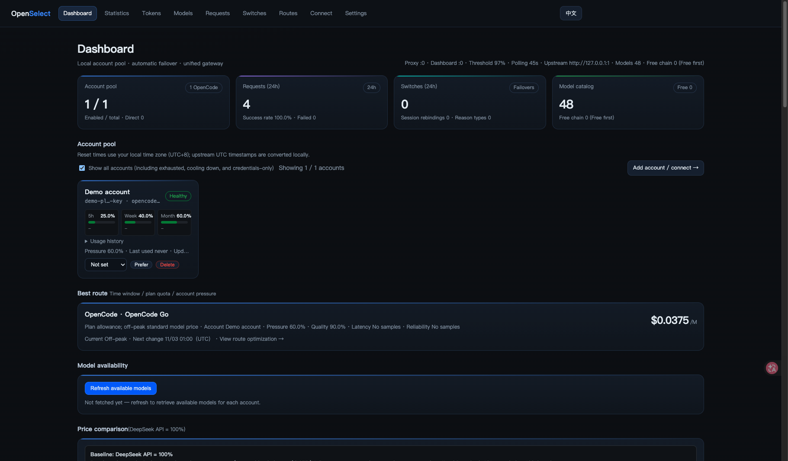
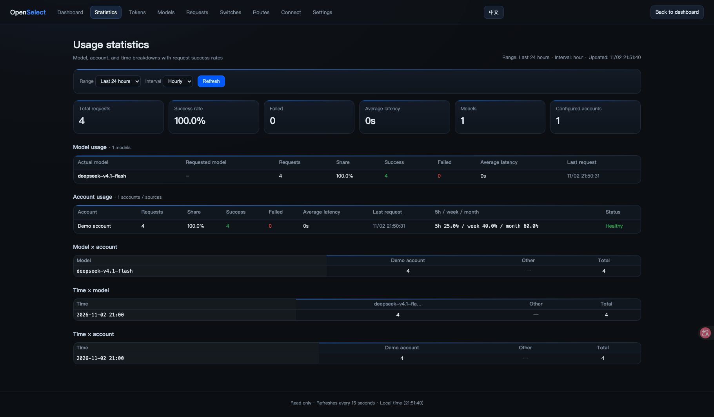
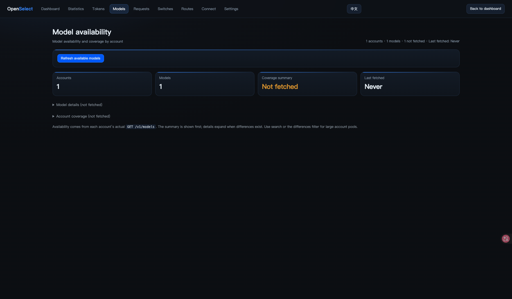
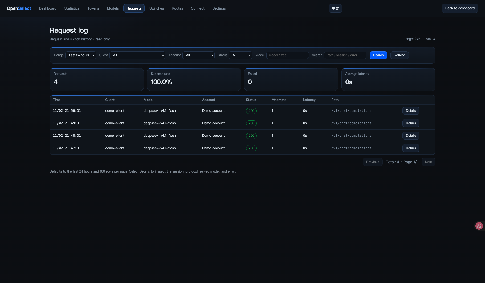
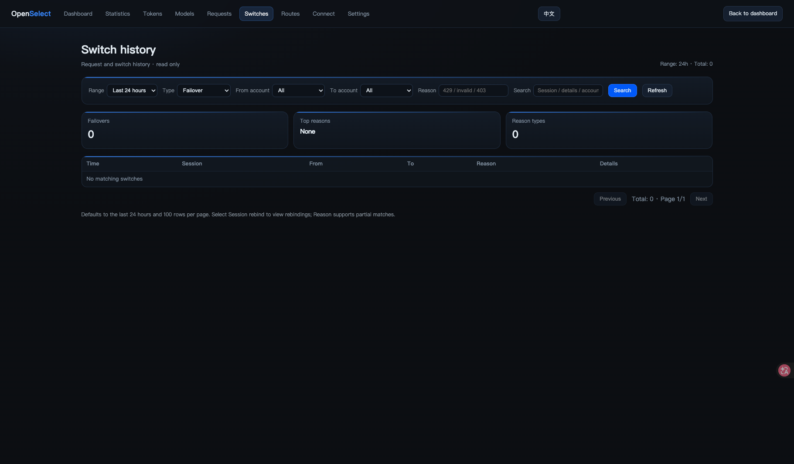
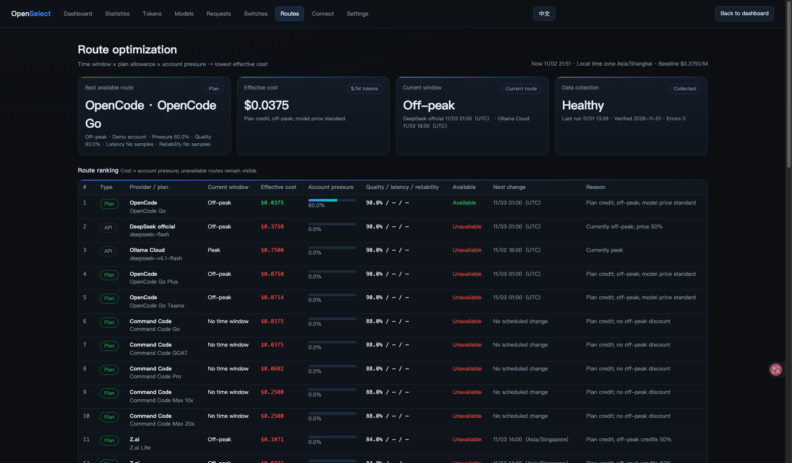
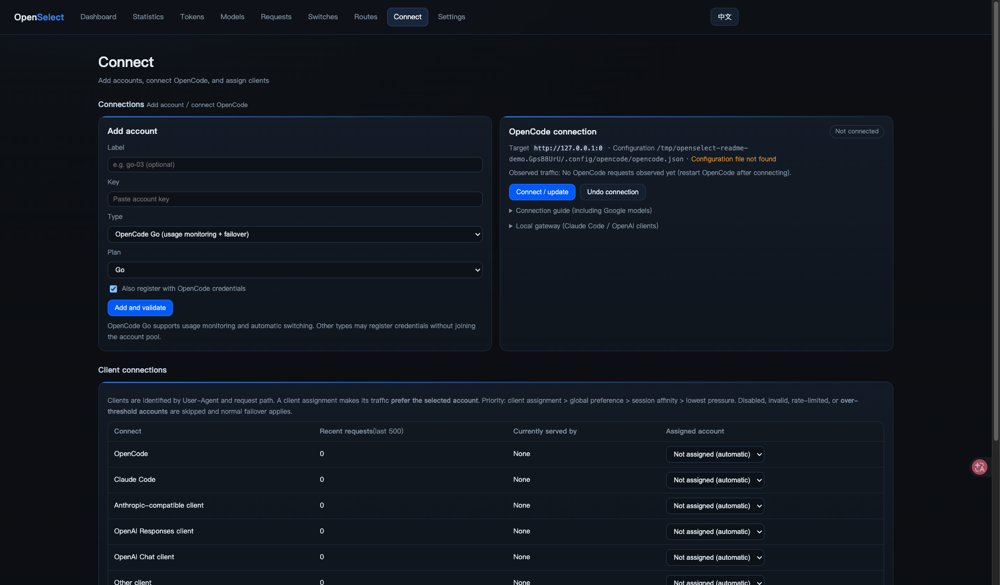
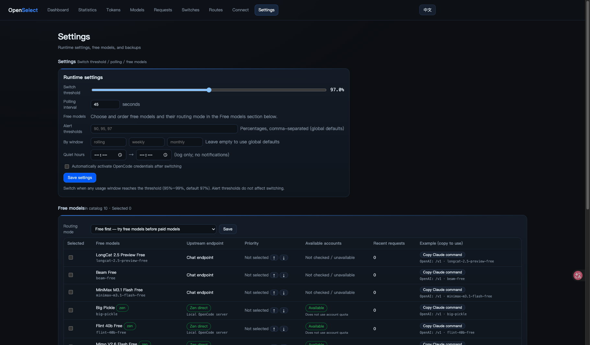

# OpenSelect

English | [简体中文](README.zh-CN.md)

OpenSelect is a local AI proxy for managing multiple provider accounts. It monitors OpenCode Go usage, routes requests through an account pool, and can retry with another account when an upstream request fails before the response starts. A local dashboard shows account status, usage, requests, and routing information.

Built with Bun and TypeScript. The proxy has no npm runtime dependencies; the dashboard supports English and Chinese.

## Features

- **Usage monitoring and account selection:** poll OpenCode Go usage and switch accounts when configured thresholds are reached. Keep sessions associated with an account when possible.
- **Request-level failover:** retry eligible rate-limit, authentication, server, and network failures before the first response bytes reach the client. Actual behavior depends on the error and available accounts.
- **Local API gateway:** use OpenAI-compatible and Anthropic-compatible endpoints through one local proxy. Some Anthropic requests can be translated to OpenAI chat requests.
- **Multiple providers:** support OpenCode Go and direct integrations including Z.ai, MiniMax, DeepSeek, Command Code, and Ollama Cloud. Capabilities depend on the provider and account.
- **Dashboard and statistics:** inspect accounts, model availability, requests, token usage, estimated cost, and routing information.
- **OpenCode integration:** connect or restore OpenCode configuration with reversible `wire` and `unwire` commands.
- **Backups:** create local backups, verify signatures, and optionally use encrypted remote backups.

### Latest improvements

- Copy launch commands for Pi, OpenCode, Hermes, and Claude Code from the Routes page. Pi declares image input, Thinking support, and a 1M context window.
- `coding-auto` filters selected routes for compatible image sources and explicit Thinking requirements. The Routes page lists capabilities; actual prompt size remains subject to upstream validation.
- Token analytics distinguish end-to-end speed, time to first content, streaming output speed, and measured retry time. Charts expose values on hover and keyboard focus. Older unmeasured records remain unknown. End-to-end request IDs now connect cross-provider attempts, total wait, and retry time; failed and cancelled streams are distinguished. Logical request counts are separate from legacy handler logs.
- Statistics share a database snapshot across aggregate views, invalidate cached results on writes, and group speed trends by local calendar boundaries.
- Scheduled remote backups support persistent encryption settings. Configure a local passphrase before enabling them; a missing passphrase prevents encrypted uploads instead of falling back to plaintext. Enabling encryption does not remove earlier remote backups.

### Route preview, automatic ordering, and recovery

The Routes page previews saved routing settings without model calls or session changes, including capability checks, account thresholds, and manual/client preferences. Manual ordering remains the default. Optional speed, reference-cost, and stability modes rank only enabled routes; speed and stability require five recent samples. Ordering uses a 60-second hold and a 15% improvement threshold. Reference cost assumes 80% uncached input and 20% output at catalogue prices, excluding subscriptions/cache discounts; it is not a bill.

Generated Pi, OpenCode, and Hermes launch configurations share model context and image metadata. Re-copy saved launch commands after updating; existing processes retain their loaded configuration. The Requests page shows the latest request IDs, their final route, and all upstream attempts.

On macOS, `opensel backup --keychain` creates or reuses a Keychain encryption secret and verifies a backup through isolated encryption, decryption, signature/manifest checks, and SQLite integrity checks. Run `opensel install` to update the existing schedule. `opensel backup --verify` and the Settings page run isolated verification without restoring live files. The dashboard reports the latest upload and verification results. Keep the Keychain entry: another machine needs the same encryption secret to restore encrypted backups. Earlier plaintext remote archives are not deleted. Remote uploads append to existing history without checking out all previous archives.

For the detailed feature reference, see [FEATURES.md](FEATURES.md) (Chinese).

## Screenshots

The English interface with sample accounts and simulated usage data:



<details>
<summary>Usage statistics</summary>



</details>

<details>
<summary>Model availability</summary>



</details>

<details>
<summary>Request log</summary>



</details>

<details>
<summary>Switch history</summary>



</details>

<details>
<summary>Routing</summary>



</details>

<details>
<summary>Connections</summary>



</details>

<details>
<summary>Settings</summary>



</details>


## Requirements

- [Bun](https://bun.sh/) and Git.
- A supported provider account and API key for provider-backed requests.
- macOS for the optional launchd automatic startup and backup tasks. The proxy itself is cross-platform.

## Quick start

```bash
git clone https://github.com/Acorne-VJ/OpenSelect.git
cd OpenSelect
./bin/opensel init
./bin/opensel serve
```

Open the dashboard at [http://127.0.0.1:8789](http://127.0.0.1:8789) and add your provider credentials on the connection page (`接入账号`). Alternatively, run `./bin/opensel import` in another terminal to import existing OpenCode Go credentials from OpenCode.

Use the **English / 中文** button in the navigation bar to switch the dashboard language. Your choice is saved in the browser.

The proxy listens on `http://127.0.0.1:8788` by default. To connect OpenCode, run the following in another terminal, then restart OpenCode:

```bash
./bin/opensel wire
```

To undo the integration, run `./bin/opensel unwire`. You can inspect the proposed changes first with `./bin/opensel wire --dry-run`.

## Configure coding-auto routes

Open the **Routes** page, select the routes to enable, use the arrows to set their priority, and save. New `coding-auto` requests try the enabled routes in that order and move to the next available route when a route reaches its quota threshold or cannot serve the request. Existing configurations retain the default Z.ai → MiniMax → OpenCode Go → DeepSeek API order until changed.

To use only the OpenCode Go DeepSeek model, select only **OpenCode Go · DeepSeek V4.1 Flash**. Requests fail when that route is unavailable instead of falling back to an unselected provider. The Routes page also offers a copyable `auto-cli` alias for the current shell. Route cost rankings are advisory and do not reorder your chosen route sequence.

## Dashboard

| Page | Purpose |
| --- | --- |
| `/` | Account pool, connections, model availability, and recent activity |
| `/connect` | Add accounts and manage client integrations |
| `/settings` | Runtime settings, free models, and backups |
| `/stats` and `/tokens` | Usage, token, and estimated-cost statistics |
| `/routes` | Provider and routing comparisons |
| `/requests` and `/switches` | Request and account-switch history |

## Command-line reference

Run `./bin/opensel --help` for the complete list and options.

| Command | Purpose |
| --- | --- |
| `./bin/opensel init` | Initialize local configuration |
| `./bin/opensel import` | Import existing OpenCode Go credentials |
| `./bin/opensel accounts` | List accounts and recent usage |
| `./bin/opensel status` | Show service and account status |
| `./bin/opensel serve` | Start the proxy, dashboard, and usage monitoring |
| `./bin/opensel wire` / `unwire` | Connect or restore OpenCode configuration |
| `./bin/opensel doctor` | Check the local setup |
| `./bin/opensel backup` / `restore` | Back up or restore local data |

## Security and privacy

Configuration, credentials, logs, and runtime data are stored under `~/.openselect/`. Keep API keys, configuration files, databases, and backups out of public repositories. **Backups can contain plaintext account keys**; use private storage or an encrypted backup.

The proxy and dashboard bind to localhost by default. Do not expose them to the public internet without suitable authentication, TLS, and a reverse proxy. See [SECURITY.md](SECURITY.md) for the security policy and reporting guidance.

## Limitations

- Failover requires another eligible account and can only replace a request before response bytes are sent to the client.
- Provider availability, model access, rate limits, and pricing can change. Enabling free-model routing may result in a different model answering the request.
- Anthropic-to-OpenAI translation supports OpenAI chat models, with limitations on some content blocks and streaming usage estimates. See the [Chinese README](README.zh-CN.md) for details.
- Automatic startup and scheduled backups use macOS launchd; the proxy itself is cross-platform.

## Development

```bash
bun install
bun test
bunx tsc --noEmit
```

The test preload isolates `HOME` in a temporary directory. See the [Chinese README](README.zh-CN.md) for configuration, backup, and implementation details.

## License

[MIT](LICENSE).
